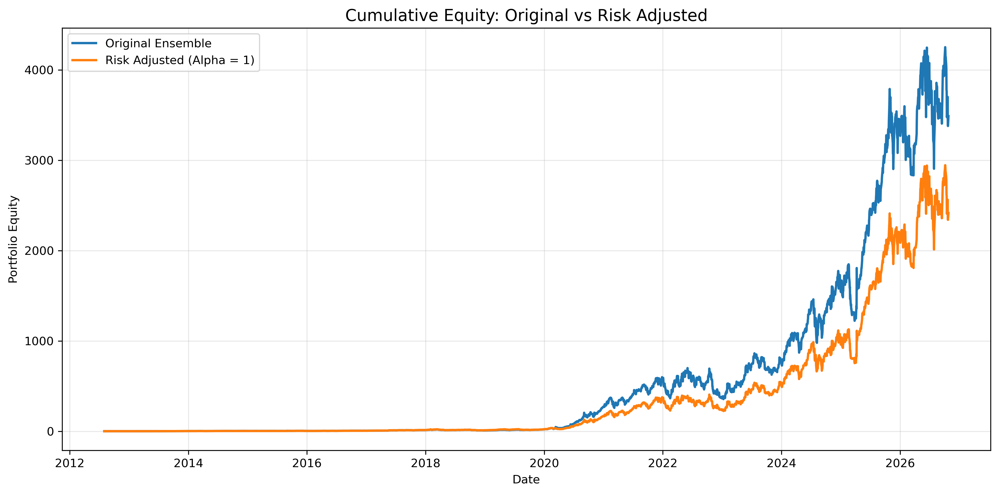
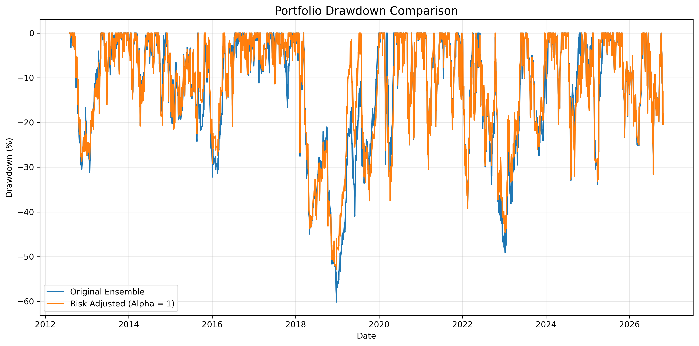
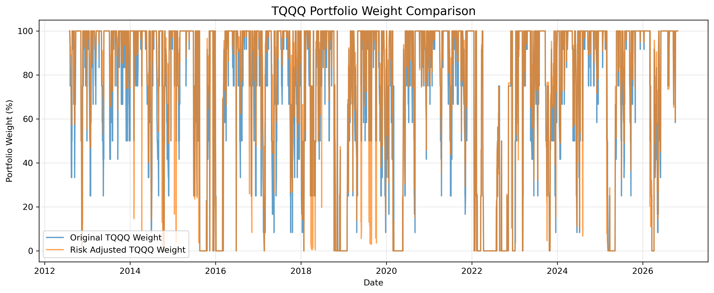

# Macro-Aware Volatility-Targeted ETF Rotation Strategy

A systematic US ETF rotation framework combining parameter-ensemble signals, inverse-volatility allocation, portfolio-level volatility targeting, and a CPI-driven tactical hedge.

## 1. Strategy Overview

The strategy is developed in four stages:

**V0 — Parameter-Ensemble Rotation**

Aggregates signals across 6,336 parameter configurations to determine ETF allocations. This provides the baseline strategy for subsequent risk management improvements.

**V1 — Inverse-Volatility Allocation**

Reweights V0 allocations using trailing 60-day historical volatility. This reduces relative exposure to more volatile ETFs but does not necessarily resolve concentrated allocations.

**V2 — Volatility Targeting**

Estimates portfolio risk using a rolling 60-day covariance matrix and applies a 30% annualized volatility target. Exposure reduced through risk scaling is allocated to BSV, a short-term Treasury bond ETF.

**Final Strategy — CPI-Triggered Tactical Hedge**

Adds a macroeconomic overlay based on CPI inflation surprises and historical QQQ opening-gap behavior. Under specified conditions, the strategy temporarily reallocates the TQQQ sleeve to UVXY, with a three-trading-day hedge and a designated closing exit.

## 2. Historical Backtest Results

Out-of-sample evaluation: January 2020 – September 2026.

| Strategy | CAGR | Annualized Volatility | Sharpe | Maximum Drawdown |
|---|---:|---:|---:|---:|
| V0 Ensemble | 116.32% | 59.37% | 1.5957 | -49.06% |
| V1 Inverse Volatility | 103.49% | 55.78% | 1.5552 | -44.64% |
| V2 Volatility Targeting | 46.69% | 30.11% | 1.4286 | -26.97% |
| V2 + CPI Overlay | 48.41% | 30.73% | 1.4438 | -26.97% |

Volatility targeting materially reduces realized volatility and maximum drawdown relative to the original ensemble strategy, at the cost of lower compounded returns. The CPI overlay modestly improves CAGR and Sharpe in the historical simulation, while slightly increasing realized volatility.

These figures are simulated results, not live investment returns.


## Strategy Visualizations

### Strategy Equity Curve



### Drawdown Comparison



### Portfolio Allocation



## 3. Methodology

The framework incorporates:

- Parameter-ensemble signal aggregation
- Rolling inverse-volatility portfolio weighting
- Covariance-based portfolio volatility forecasting
- Dynamic volatility targeting and defensive allocation
- CPI surprise detection and conditional ETF hedging
- Transaction-cost-aware portfolio simulation
- In-sample and out-of-sample performance evaluation

Trading signals are implemented using prior-known information. Regular portfolio rebalancing is simulated at the next valid market opening, with transaction costs applied to executed notional amounts. CPI hedge exits may execute at the designated closing price.

## 4. Data and Evaluation

Market data consists of US ETF daily prices obtained through Yahoo Finance, alongside a separately maintained CPI release dataset containing actual and forecast inflation observations.

The historical simulation uses a continuous portfolio account from August 2012, with the following evaluation windows:

| Period | Dates |
|---|---|
| In-Sample | 2012-08-01 to 2019-12-31 |
| Out-of-Sample | 2020-01-01 to 2026-09-30 |
| OOS excluding 2020 | 2021-01-01 to 2026-09-30 |

The OOS boundary is a reporting boundary, not a portfolio reset or new capital injection.

## 5. How to Run

Install Python 3.10 or later and the project dependencies:

```bash
python3 -m pip install -r requirements.txt
```

Run the complete historical strategy pipeline using the existing market dataset:

```bash
python3 run_all.py
```

Optionally refresh US ETF market data before rebuilding the strategy:

```bash
python3 run_all.py --update-data
```

The data refresh downloads ETF prices only. CPI observations must be maintained separately. The data-refresh option has not yet been fully validated through a live download.

On macOS, `run_all.command` provides a double-click launcher that prepares a local Python environment, executes the pipeline, and opens the generated HTML report.

## 6. Outputs

The pipeline produces:

- `results/tables/us_strategy_metrics.csv` — performance metrics
- `results/tables/us_strategy_equity.csv` — strategy equity histories
- `results/US_Strategy_Report.html` — HTML performance summary
- `results/signals/` — historical target weights
- `results/figures/` — strategy diagnostics and visualization outputs

## 7. Limitations

This project is an empirical research backtest, not an executable brokerage trading system.

Results are sensitive to historical price data, execution-price assumptions, transaction costs, parameter choices, and the behavior of leveraged and inverse ETFs. The volatility target is an ex-ante risk control rather than a guarantee of realized risk.

Although the evaluation uses designated in-sample and out-of-sample periods, some strategy and CPI overlay parameters may have been informed by historical observations. Reported OOS performance should therefore not be interpreted as a fully untouched holdout test.

The strategy does not include a verified live-trading track record.

## 8. Technology

Python, pandas, NumPy, SciPy, Matplotlib, Jupyter Notebook, yfinance, and Git.